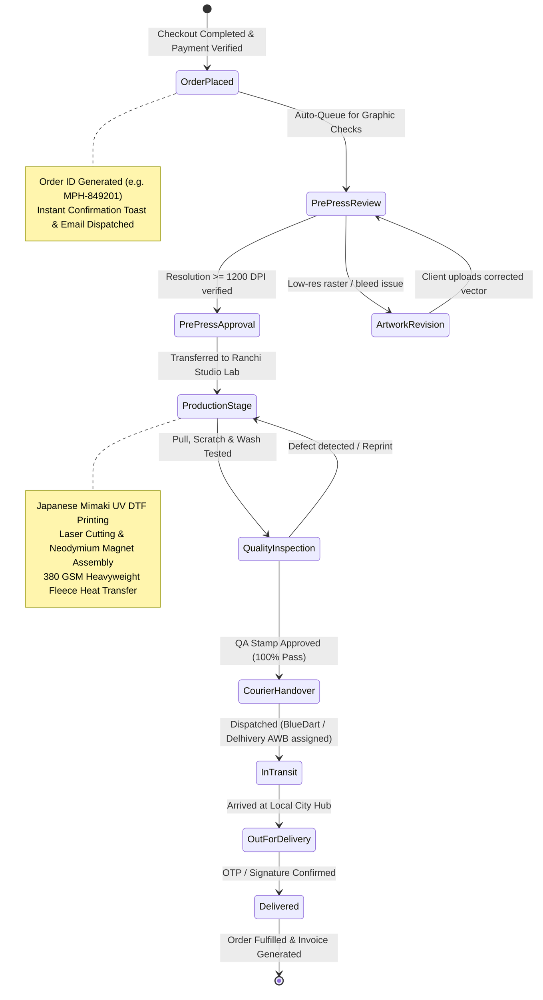
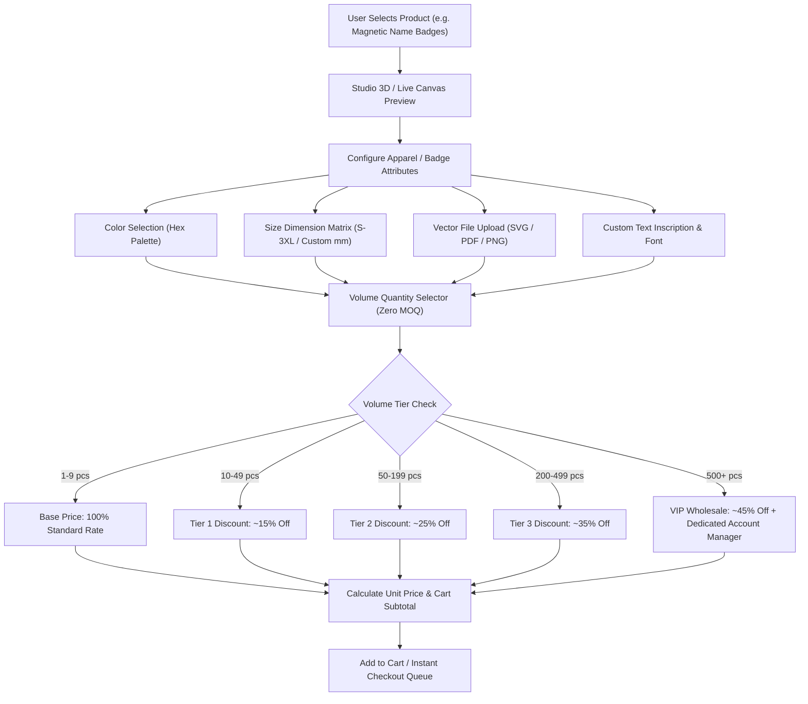
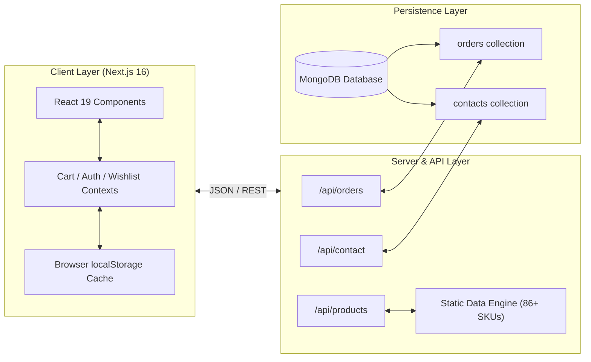

# MyPrintHub Database & Application Schema Architecture

This document provides the formal data models, Entity-Relationship Diagrams (ERD), state machines, and system flow architectures for the **MyPrintHub.in** platform.

---

## 1. Entity-Relationship Diagram (ERD)

```mermaid
erDiagram
    CUSTOMER ||--o{ ORDER : "places"
    CUSTOMER ||--o| USER_ADDRESS : "maintains_default"
    CUSTOMER ||--o| CORPORATE_BILLING : "configures"
    CUSTOMER ||--o{ WISHLIST_ITEM : "saves"
    CUSTOMER ||--o{ INQUIRY_TICKET : "submits"
    
    CATEGORY ||--o{ PRODUCT : "classifies"
    PRODUCT ||--|{ TIERED_PRICING : "defines_volume_discounts"
    PRODUCT ||--o{ ORDER_ITEM : "ordered_as"
    PRODUCT ||--o{ WISHLIST_ITEM : "saved_as"
    
    ORDER ||--|{ ORDER_ITEM : "contains"
    ORDER ||--|{ TRACKING_EVENT : "progresses_through"
    ORDER ||--|| SHIPPING_ADDRESS : "delivers_to"
    COUPON ||--o{ ORDER : "applied_on"

    CUSTOMER {
        string email PK "User unique identifier"
        string fullName "Customer name"
        string phone "10-digit mobile number"
        string passwordHash "Encrypted credential"
        string joinedDate "Membership registration date"
        string role "retail_buyer | corporate_client"
    }

    USER_ADDRESS {
        string street "Street address and landmarks"
        string city "City / Municipal hub"
        string state "State / Territory"
        string pincode "6-digit postal code"
        boolean isDefault "Primary delivery target"
    }

    CORPORATE_BILLING {
        string companyName "Registered enterprise title"
        string gstNumber "15-digit GSTIN tax ID"
        string billingAddress "Registered tax office"
    }

    CATEGORY {
        string id PK "Category slug identifier"
        string name "Display title"
        string description "Category overview"
        string image "Category showcase visual"
        int itemCount "Total available products"
        string badge "Zero MOQ | High Demand"
    }

    PRODUCT {
        string id PK "Unique product identifier"
        string slug "SEO canonical URL slug"
        string name "Commercial title"
        string categorySlug FK "Parent category"
        float basePrice "Single unit price (INR)"
        float originalPrice "MRP comparison price"
        float rating "Aggregate star rating (1-5)"
        int reviewsCount "Total verified reviews"
        string image "Hero thumbnail URL"
        string printArea "Printable dimensions (e.g. 3.5x3.5 in)"
        boolean customizable "Supports custom vector/text"
        boolean inStock "Live factory inventory status"
    }

    TIERED_PRICING {
        int minQty "Minimum volume threshold"
        int maxQty "Upper volume threshold (null = uncapped)"
        float unitPrice "Discounted factory unit price"
        string savings "Percentage discount label"
    }

    ORDER {
        string orderId PK "Unique tracking reference (e.g. MPH-849201)"
        string customerEmail FK "Ordering customer"
        float subtotal "Pre-discount items aggregate"
        float discount "Coupon and volume savings"
        float shippingFee "Delivery charge (0 for qualifying orders)"
        float total "Final payable amount (INR)"
        string paymentMethod "UPI | Credit Card | Corporate NetBanking"
        string paymentStatus "paid | pending"
        string currentStatus "Current dispatch state"
        string courierPartner "BlueDart | Delhivery | DTDC"
        string awbNumber "Air Waybill courier tracking code"
        date createdAt "Order placement timestamp"
    }

    ORDER_ITEM {
        string productId FK "Referenced product"
        string name "Product snapshot title"
        string category "Product category"
        float unitPrice "Locked purchase unit price"
        int quantity "Ordered volume"
        string selectedColor "Selected hex or color name"
        string selectedSize "Selected apparel or badge dimensions"
        string customText "Customer custom text inscription"
        string customImage "Uploaded vector/raster artwork URL"
    }

    TRACKING_EVENT {
        int stage "Milestone sequential index (1-5)"
        string title "Milestone headline"
        string desc "Technical milestone description"
        string date "Timestamp of completion"
        boolean completed "Progress boolean indicator"
    }

    COUPON {
        string code PK "Redemption voucher code"
        float discountPercent "Percentage deduction"
        float maxDiscount "Maximum monetary cap"
        float minOrder "Minimum cart subtotal requirement"
        string description "Promotional campaign details"
    }

    INQUIRY_TICKET {
        string id PK "Unique enterprise ticket ID"
        string name "Contact person name"
        string email "Business contact email"
        string phone "Direct contact phone number"
        string company "Organization name"
        string productInterest "Product line interest"
        string quantity "Estimated order size"
        string message "Project requirements specification"
        string status "new | in_review | contacted | closed"
    }

    WISHLIST_ITEM {
        string customerEmail FK "Owner email"
        string productId FK "Bookmarked product"
        date addedAt "Bookmark timestamp"
    }
```

---

## 2. Order Lifecycle & Industrial Fulfillment State Machine

---

## 3. Product Customization & Tiered Pricing Architecture

---

## 4. Full Model Specification

### 4.1 Order Model (`src/models/Order.ts`)
| Field | Type | Required | Default | Description |
|---|---|---|---|---|
| `orderId` | `String` | Yes | (Generated) | Unique index formatted reference (e.g. `MPH-849201`). |
| `customer.fullName` | `String` | Yes | - | Customer full name. |
| `customer.email` | `String` | Yes | - | Customer contact and notification email. |
| `customer.phone` | `String` | Yes | - | 10-digit primary phone number. |
| `shippingAddress.address` | `String` | Yes | - | Street address, apartment, or studio unit. |
| `shippingAddress.city` | `String` | Yes | - | City or metropolitan center. |
| `shippingAddress.state` | `String` | Yes | - | State or union territory. |
| `shippingAddress.pincode` | `String` | Yes | - | 6-digit Indian PIN code. |
| `items` | `Array<IOrderItem>` | Yes | `[]` | Embedded list of ordered customized products. |
| `subtotal` | `Number` | Yes | `0` | Base items total before discount/tax. |
| `discount` | `Number` | Yes | `0` | Applied coupon and tier savings. |
| `shipping` | `Number` | Yes | `0` | Shipping fee (`₹0` if subtotal >= `₹999`). |
| `total` | `Number` | Yes | `0` | Final payable balance. |
| `paymentMethod` | `String` | Yes | `"UPI"` | `"UPI"`, `"Credit Card"`, `"Debit Card"`, `"NetBanking"`. |
| `paymentStatus` | `String` | Yes | `"pending"` | `"paid"` or `"pending"`. |
| `status` | `String` | Yes | `"Order Placed & Confirmed"` | High-level status string matching live tracking stages. |
| `tracking.courier` | `String` | No | `"BlueDart Express"` | Logistics provider name. |
| `tracking.awbNumber` | `String` | No | - | Live AWB courier barcode code. |
| `timeline` | `Array<ITrackingEvent>`| Yes | `[]` | 5-stage sequential fulfillment milestones. |

---

### 4.2 Product Model (`src/types/index.ts`)
| Field | Type | Required | Description |
|---|---|---|---|
| `id` | `string` | Yes | Unique alphanumeric ID. |
| `slug` | `string` | Yes | SEO URL slug. |
| `name` | `string` | Yes | Full commercial display title. |
| `category` | `string` | Yes | Human-readable category title. |
| `categorySlug` | `string` | Yes | Category route slug. |
| `price` | `number` | Yes | Base unit selling price in INR. |
| `originalPrice` | `number` | Yes | Reference MRP comparison figure. |
| `rating` | `number` | Yes | Average rating (out of 5.0). |
| `reviewsCount` | `number` | Yes | Total customer reviews recorded. |
| `image` | `string` | Yes | Primary high-res thumbnail image URL. |
| `gallery` | `string[]` | Yes | Multi-angle studio photography URLs. |
| `description` | `string` | Yes | Technical and material description. |
| `features` | `string[]` | Yes | Key specifications bullet list. |
| `colors` | `ProductColor[]` | Yes | Available color variants with hex codes. |
| `sizes` | `string[]` | No | Available sizing options (apparel, frames, badges). |
| `minQuantity` | `number` | Yes | Minimum allowable order (`1` for Zero MOQ). |
| `tieredPricing` | `TieredPrice[]` | Yes | Volume quantity bracket price tables. |
| `inStock` | `boolean` | Yes | Active inventory availability. |
| `customizable` | `boolean` | Yes | Flag indicating live online editor support. |
| `printArea` | `string` | No | Recommended safe printable artwork bounds. |

---

### 4.3 Enterprise Contact & Bulk Inquiry Model (`src/models/Contact.ts`)
| Field | Type | Required | Default | Description |
|---|---|---|---|---|
| `name` | `String` | Yes | - | Inquiring client or manager name. |
| `email` | `String` | Yes | - | Business email address. |
| `phone` | `String` | Yes | - | Direct phone number. |
| `company` | `String` | No | - | Company or institution name. |
| `productInterest` | `String` | No | `"General Inquiry"` | Product line of interest. |
| `quantity` | `String` | No | - | Target volume range (e.g. `500-1,000 pcs`). |
| `message` | `String` | Yes | - | Specific customization or timeline requirements. |
| `status` | `String` | Yes | `"new"` | `"new"`, `"in_review"`, `"contacted"`, `"closed"`. |

---

## 5. System Technology & Storage Architecture

